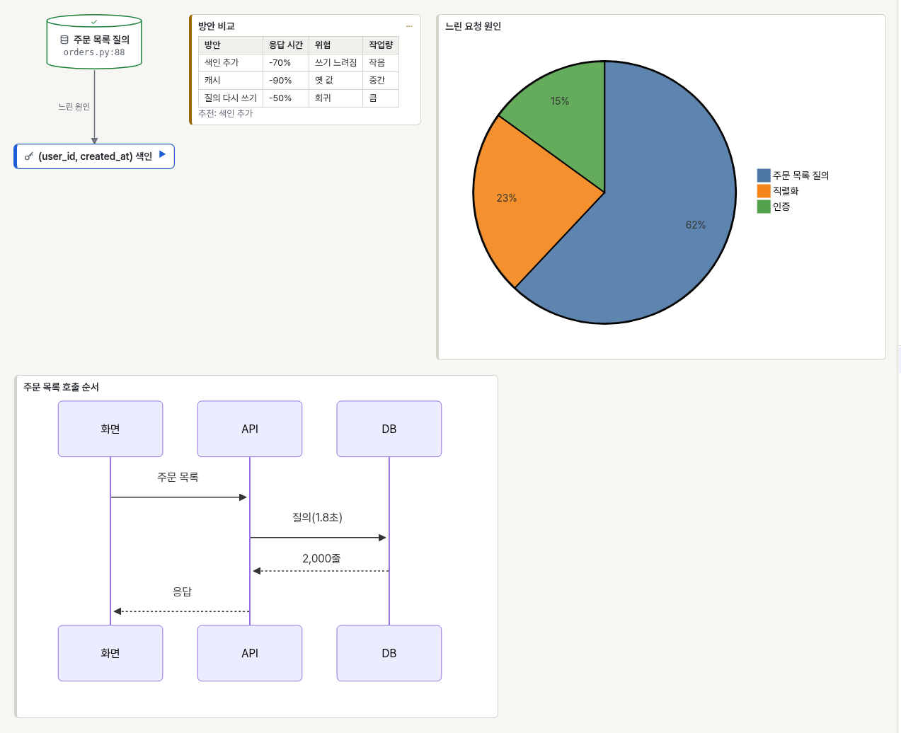
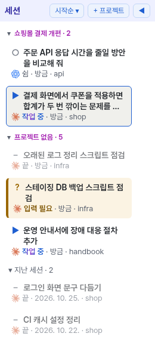
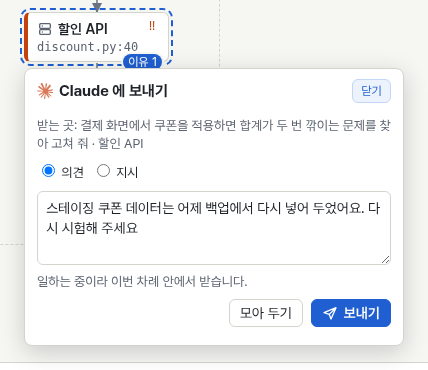
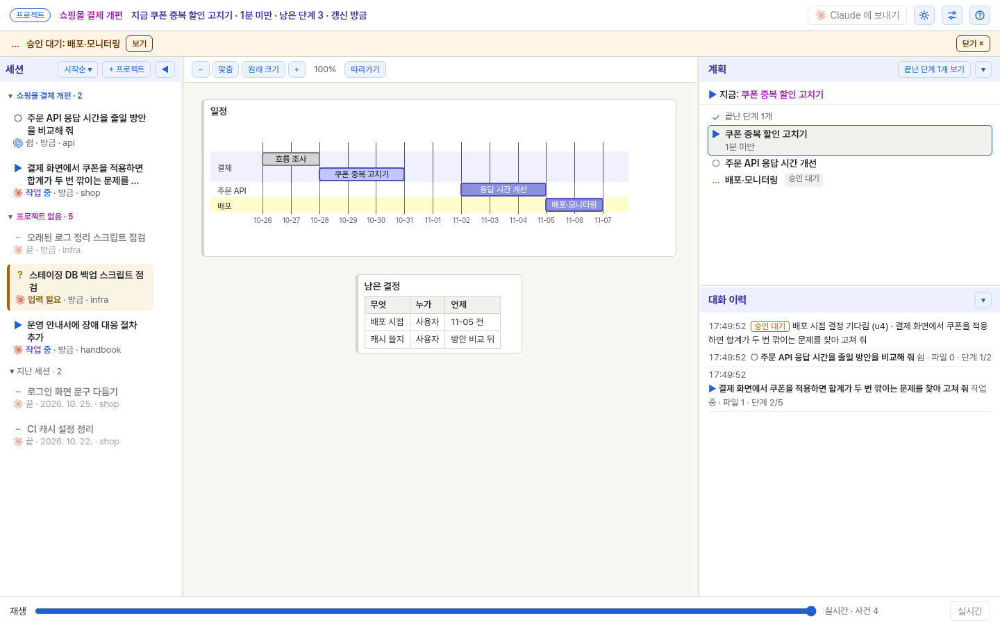

# AnyTaskView

<picture>
  <source media="(prefers-color-scheme: dark)" srcset="docs/images/hero-dark.png">
  
</picture>

**English summary.** anytaskview is a Linux plugin for coding agents (Claude Code and OpenAI Codex) that shows what the agent is doing on a live board in your local browser: the plan and its current step, a diagram the agent keeps extending while it works (finished groups fold into one box you can click open), notes and decisions, and facts collected automatically by hooks (file edits, commands, subagents). Work that spans several conversations is grouped into projects, each with a big-picture board that stays until the work is done. You can point at a box or a step on the board and send a comment or instruction back to the agent, search the board and past records, and drag shapes with Ctrl held to rearrange them. The board UI and agent-facing texts are in Korean, and so are the screenshots in this README.

- Supported agents: Claude Code (tested in the terminal `claude`) and OpenAI Codex (terminal `codex`, ChatGPT desktop app, VS Code). Other agents are not supported yet.
- Requirements: Linux (macOS untested, Windows through WSL), Node.js 22.12 or later, a recent browser, and Claude Code or Codex with plugin support.
- Install: `claude plugin marketplace add makefiles/anytaskview`, then `claude plugin install anytaskview@anytaskview`. Step-by-step guide that an LLM agent can also follow: [INSTALL.md](INSTALL.md). Agents given only this repository URL should follow INSTALL.md from the top; the two commands alone do not start or open the board. To open the board later, ask the agent to open it, or run `scripts/atv board --open` from the plugin folder (it opens your default browser without printing the key).
- OpenAI Codex (CLI, desktop app, VS Code) works too: `codex plugin marketplace add makefiles/anytaskview`, `codex plugin add anytaskview@anytaskview`, allow the five board tools in `~/.codex/config.toml`, and trust the hooks in `/hooks`. See the Codex part of [INSTALL.md](INSTALL.md).
- Security: the board listens on 127.0.0.1 only and every request needs a token; nothing is sent off the machine. Details and limits: [SECURITY.md](SECURITY.md).
- License: Apache-2.0. Bundled browser libraries and the font keep their own licenses (ELK: EPL-2.0, Mermaid: MIT, Pretendard: SIL OFL 1.1).
- Trademarks: Claude and the Claude logo are trademarks of Anthropic, PBC; Codex, ChatGPT and the OpenAI logo are trademarks of OpenAI. The board shows these logos (the OpenAI logo recoloured blue for Codex sessions) only to tell which agent a session belongs to. anytaskview is not affiliated with or endorsed by either company.

---

코딩 에이전트(Claude Code, OpenAI Codex)가 일하는 동안 지금 하는 일을 이 PC 의 브라우저 화판에 실시간으로 보여 주는 Linux 용 플러그인입니다.

- 에이전트가 계획(단계)과 문제 구조 그림, 이유·결정 메모를 짧은 도구 호출로 올립니다.
- 파일 수정, 명령, 하위 에이전트, 입력 필요 같은 사실은 에이전트의 훅이 자동으로 올립니다. 사실은 그때의 단계에 붙고, 그림 속 상자의 파일이 수정되면 그 상자에 「수정됨」 이 붙습니다.
- 여러 대화에 걸친 일은 프로젝트로 묶이고, 프로젝트마다 끝날 때까지 이어지는 큰 그림 화판이 있습니다.
- 화판의 상자나 단계를 가리켜 그 자리에서 에이전트에 의견·지시를 보낼 수 있습니다.

## 지원하는 에이전트

| 에이전트 | 쓰는 곳 | 비고 |
|---|---|---|
| Claude Code | 터미널 `claude` | 모든 기능을 씁니다. 데스크톱 앱·IDE 확장은 시험하지 않았습니다. |
| OpenAI Codex | 터미널 `codex`, ChatGPT 데스크톱 앱, VS Code | 모든 기능을 씁니다(`codex-cli` 0.163·0.164 에서 시험). 설치 뒤 그리기 도구를 허용하고 훅을 믿어 줘야 하며, 화판에서 보낸 글은 일하는 중이면 그 차례가 끝난 뒤 받습니다. |
| 그 밖의 에이전트 | | 아직 지원하지 않습니다. |

세션 목록에는 Claude·Codex 로고가 붙어 어느 에이전트의 세션인지 보입니다. 화면 글과 에이전트에 주는 안내는 한국어입니다.

## 필요한 것

- Linux. macOS 는 시험하지 않았고, Windows 는 WSL 에서 씁니다.
- Claude Code 또는 OpenAI Codex(플러그인을 쓰는 판)
- Node.js 22.12 이상. `PATH` 의 node 가 오래됐으면 nvm 으로 깐 node 를 찾아 쓰고, 그래도 없으면 `ANYTASKVIEW_NODE` 에 node 경로를 넣습니다.
- Chrome·Edge·Firefox 같은 최근 브라우저

실행에 필요한 npm 패키지는 없습니다(브라우저 라이브러리와 글꼴은 `web/vendor/` 에 들어 있습니다).

## 설치

### Claude Code

터미널에서:

```sh
claude plugin marketplace add makefiles/anytaskview
claude plugin install anytaskview@anytaskview
```

Claude Code 안에서는 `/plugin marketplace add makefiles/anytaskview` 와 `/plugin install anytaskview@anytaskview` 입니다. 이미 열려 있는 세션에서는 `/reload-plugins` 를 실행합니다.

자세한 순서와 확인 방법, 갱신·삭제는 [INSTALL.md](INSTALL.md) 에 있습니다.

### OpenAI Codex

터미널 `codex`, ChatGPT 데스크톱 앱, VS Code 의 Codex 에서 씁니다. `codex plugin marketplace add makefiles/anytaskview` 와 `codex plugin add anytaskview@anytaskview` 로 설치하고, 그리기 도구 다섯을 사용자 Codex 설정에서 늘 허용한 뒤 `/hooks` 에서 훅을 믿어 줍니다. 순서는 [INSTALL.md](INSTALL.md) 의 「Codex 에 설치」 에 있습니다. Codex 세션은 목록 줄에 파란 OpenAI 로고가 붙고, 화판에서 보낸 글은 쉬는 세션이면 바로, 일하는 중이면 그 차례가 끝난 뒤 받습니다.

### LLM 에게 설치를 맡기려면

Claude Code·Codex 같은 코딩 에이전트에 이렇게 말하면 됩니다.

> https://github.com/makefiles/anytaskview 의 INSTALL.md 를 읽고 그대로 설치하고 확인해 줘

저장소 주소만 받은 에이전트도 위 두 명령에서 멈추지 말고 INSTALL.md 를 처음부터 따라야 합니다(두 명령만으로는 화판이 뜨거나 열리지 않습니다). INSTALL.md 는 에이전트가 그대로 따라 할 수 있도록 명령과 확인 기준을 단계마다 적었습니다. 화판 주소에는 비밀 값이 들어 있으므로, 에이전트는 주소를 찍지 않는 `--open` 으로 브라우저를 열고 주소를 대화창에 옮겨 적지 않게 했습니다.

## 처음 열기

가장 쉬운 방법은 Claude Code(또는 Codex) 세션에서 「화판 열어 줘」 라고 하는 것입니다. 에이전트가 아래 명령을 실행해 화판 서버를 띄우고(없으면) 이 PC 의 기본 브라우저로 엽니다. 열쇠가 든 주소는 화면이나 대화에 찍히지 않습니다. 터미널에서 직접 실행해도 됩니다.

```sh
"$(for d in ~/.claude/plugins/cache/anytaskview/anytaskview/*/; do [ -e "${d}.orphaned_at" ] || echo "$d"; done | tail -n 1)scripts/atv" board --open
```

Codex 로만 설치했다면 플러그인 폴더가 `~/.codex/plugins/cache/anytaskview/anytaskview/local/` 이므로 `~/.codex/plugins/cache/anytaskview/anytaskview/local/scripts/atv board --open` 을 실행합니다.

한 번 연 뒤로는 그 브라우저에서 `http://127.0.0.1:4871/` 만 열면 됩니다. PC 를 다시 켜도 기록은 상태 폴더에 남아 있어, 세션을 열고 화판을 다시 열면 그대로 보입니다.

브라우저를 여는 명령이 없는 환경(원격 셸 따위)에서는 같은 명령을 `--url` 로 바꿔 실행하고, 찍힌 주소를 이 PC 의 브라우저로 한 번 엽니다.

주소에는 읽기 토큰(`?t=`)과 화판 쓰기 열쇠(`#w=`)가 들어 있습니다. 다른 사람에게 보내거나 이슈·대화에 붙이지 마세요. `--url` 은 이 사용자의 화판 서버가 떠 있을 때만 주소를 줍니다.

## 화면

### 그림: 내용에 맞는 형식을 섞어 그립니다

<picture>
  <source media="(prefers-color-scheme: dark)" srcset="docs/images/forms-dark.png">
  
</picture>

에이전트는 상태를 고쳐 갈 부분은 상자(둥근 네모·마름모·원통·문서·육각형 모양과 아이콘)와 선으로, 비교·결과는 표로, 호출 순서·비율·일정은 Mermaid 다이어그램과 차트로 그립니다. 상자의 테두리 색과 기호가 진행·끝·실패·막힘·승인 대기를 보입니다.

### 세션 목록 · 가리키고 보내기

<picture>
  <source media="(prefers-color-scheme: dark)" srcset="docs/images/sessions-dark.png">
  
</picture>
<picture>
  <source media="(prefers-color-scheme: dark)" srcset="docs/images/send-dark.png">
  
</picture>

세션은 프로젝트별로 묶이고, Claude·Codex 로고로 어느 에이전트의 세션인지 보입니다. 작업 중인 세션은 파란 띠·바탕에 「작업 중」 글자가 반짝이고, 입력이 필요한 세션은 주황 띠·바탕에 「입력 필요」 글자가 반짝입니다. 지금 보는 세션이 일하는 동안에는 계획의 「지금」 줄도 반짝입니다. 상자나 단계에 마우스를 올리면 뜨는 「보내기」 로 그 자리에 대해 의견·지시를 보냅니다.

### 프로젝트 큰 그림

<picture>
  <source media="(prefers-color-scheme: dark)" srcset="docs/images/project-dark.png">
  
</picture>

여러 대화에 걸친 일은 프로젝트의 큰 그림 화판에 작업 단위(끝난 것·지금·다음에 할 것을 차례대로 이은 그림)·남은 결정·대화 이력으로 남습니다.

### 화면 구성

- 왼쪽: 세션 목록. 프로젝트별로 묶이고, 목록 위 정렬 단추(처음에는 「시작순 ▾」)에서 시작순·활동순·이름순을 고르거나 끝난 세션을 숨깁니다. 끝난 지 하루가 지난 대화는 「지난 세션」 에 접혀 들어갑니다. 프로젝트 이름을 누르면 큰 그림이 열립니다.
- 가운데: 에이전트가 그린 그림. 내용에 맞춰 상자(모양·아이콘)와 선, 표, Mermaid 다이어그램·차트(시퀀스·상태·간트·타임라인·원·막대 등)를 섞어 그립니다. 상자를 누르면 파일 경로를 복사합니다. `Ctrl` 을 누른 채 도형을 끌면 원하는 자리로 옮기고, 놓은 자리는 기록에 남습니다(그림 위 「자동 배치로」 로 모두 되돌림). 그림이 지금 작업의 계획보다 먼저 그린 것이면 그림 위에 「지난 작업 때 그린 그림」 이 붙습니다. 같은 일의 뒤 작업은 그림을 지우지 않고 새 묶음으로 덧붙이고, 끝난 묶음은 상자 하나로 접혀 누르면 펼쳐집니다.
- 오른쪽: 계획(지금 단계는 위에 고정)과 타임라인(사실·메모·보낸 글). 타임라인은 「새 창」 으로 떼어 볼 수 있습니다.
- 아래: 재생 막대. 지난 상태를 처음부터 다시 봅니다.
- 맨 위 주의 띠(입력 필요·승인 대기·막힘·실패, 끝난 묶음 안의 실패는 빼고)는 한 줄로 접혀 「외 N개」 로 펴고, 「닫기」 로 숨깁니다(새 알림이 오면 다시 보임). 그림이 칸보다 크면 마우스로 잡아 끌어 옮깁니다.
- 맨 위 「찾기」(`/` 또는 `Ctrl+K`)는 이 화판의 그림·계획, 이 세션의 타임라인(옛 기록까지), 세션·프로젝트, 다른 세션의 기록에서 찾고, 고르면 그 자리로 갑니다.
- 상자나 단계에 마우스를 올리거나 초점을 두면 「보내기」 가 뜹니다. 여러 글을 「모아 두기」 로 모았다가 한꺼번에 보낼 수도 있습니다. 쓰다 둔 글과 모은 글은 브라우저를 닫아도 남습니다.
- 맨 위 「설정」 에서 이어받기 문구(예: `이어서 <키>`)를 정하면, 그 문구로 시작한 대화를 같은 키의 앞 대화와 프로젝트에 잇습니다. 기본은 꺼져 있습니다.
- 끝난 뒤 30일이 지난 대화는 휴지통(`~/.local/state/anytaskview/trash/`, 30일 뒤 비움)으로 옮깁니다. 진행 중인 프로젝트에 든 대화는 남깁니다. 날수는 「설정」 에서 바꾸거나 끕니다.
- 자세한 사용법은 화면의 「도움말」(`?` 키)에 있습니다.

## 데이터와 보안

- 화판 서버는 127.0.0.1 에만 묶이고, 모든 요청에 토큰이 필요합니다. 이 PC 밖으로 보내는 것은 없습니다.
- 기록은 `~/.local/state/anytaskview/` 에 이 사용자만 읽을 수 있게 둡니다(`ANYTASKVIEW_HOME` 으로 바꿀 수 있습니다). 사용자 입력과 명령 줄, 파일 경로가 들어가며 흔한 비밀 모양은 가립니다.
- 여러 사용자 계정이 함께 쓰는 컴퓨터에서는 권하지 않습니다(화판 서버가 꺼진 사이 다른 사용자가 포트를 잡으면 브라우저의 열쇠를 가로챌 수 있습니다).
- 남은 한계와 신고 방법은 [SECURITY.md](SECURITY.md) 에 있습니다.

## 문제 해결

- 화판이 안 뜸: 에이전트 세션을 새로 열거나, 위의 `scripts/atv board` 로 직접 띄웁니다. 로그는 `~/.local/state/anytaskview/board.log` 입니다.
- 「쓰기 열쇠 없음」 이 보임: `scripts/atv board --open` 으로 다시 엽니다(다른 브라우저·시크릿 창·쿠키를 지운 경우).
- 플러그인을 갱신한 뒤 「화판 서버가 다른 판」 이라고 나옴: 옛 판 서버를 내립니다(INSTALL.md 「갱신」).
- node 를 찾지 못함: `ANYTASKVIEW_NODE=/path/to/node` 를 Claude Code·Codex 를 띄우는 환경에 넣습니다.

## 개발

```sh
npm install                  # 시험 도구와 브라우저 라이브러리 원본(실행에는 필요 없음)
npm test                     # 장면 규칙, 서버 보안, 훅, MCP, 선 길 찾기
node verify/probe_ui.js      # 화면 없는 Chrome 으로 화면 확인(Chrome 필요)
node verify/readme_shots.js  # 이 README 의 화면 이미지(docs/images) 다시 찍기(예시 데이터만, Chrome 필요)
claude --plugin-dir .        # 이 폴더를 한 세션에만 붙여 시험
```

구조와 동작의 자세한 규칙은 [docs/internals.md](docs/internals.md) 에 있습니다.

## 라이선스

Apache License 2.0 ([LICENSE](LICENSE)). `web/vendor/` 의 ELK(EPL-2.0), Mermaid(MIT), 글꼴 Pretendard(SIL OFL 1.1)는 각자의 라이선스를 따릅니다([web/vendor/README.md](web/vendor/README.md)).

Claude 와 Claude 로고는 Anthropic, PBC 의, Codex·ChatGPT 와 OpenAI 로고는 OpenAI 의 상표입니다. 화판은 세션이 어느 에이전트의 것인지 알아보게 하려고만 이 로고를 보이며(Codex 세션에는 OpenAI 로고를 파란색으로 칠해 씁니다), anytaskview 는 두 회사와 관계가 없고 두 회사의 보증을 받지 않았습니다.
