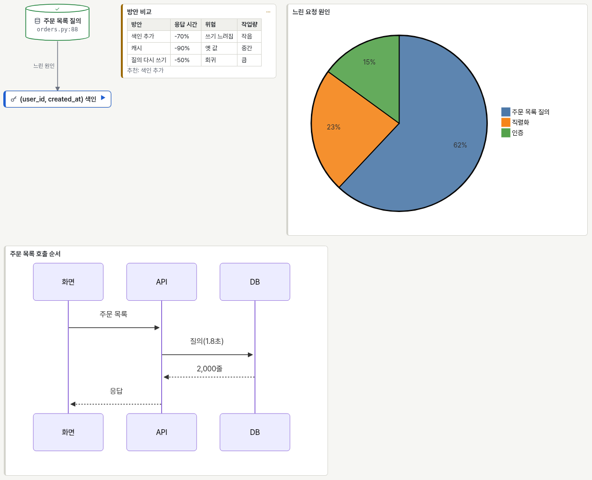
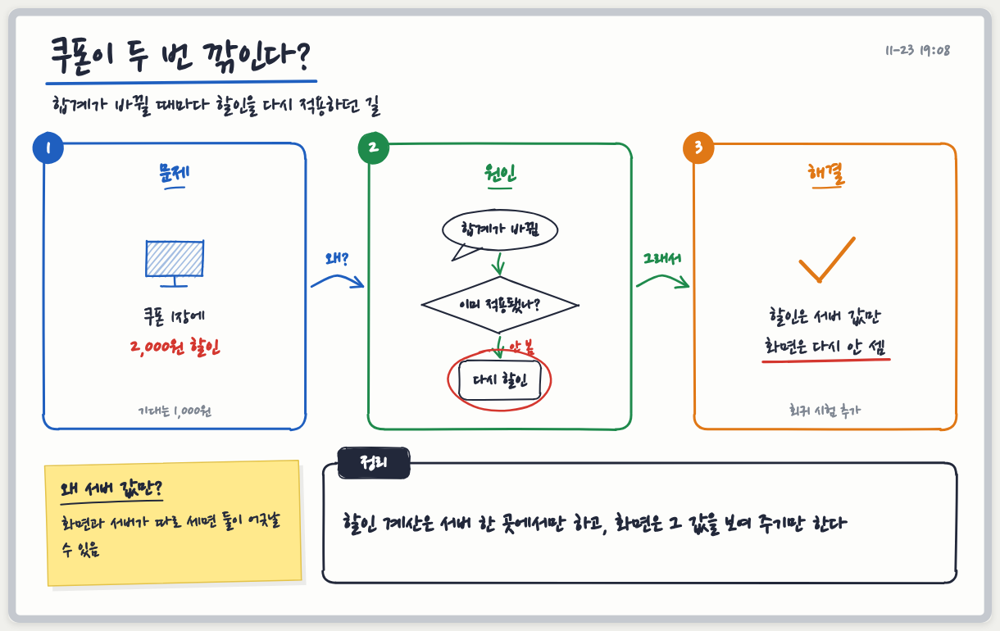
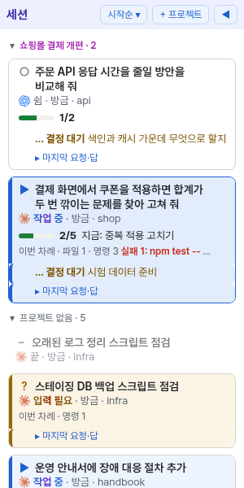
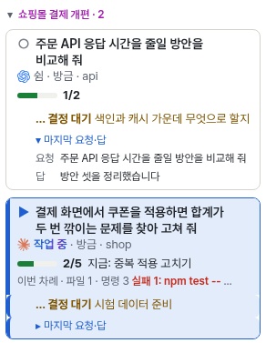
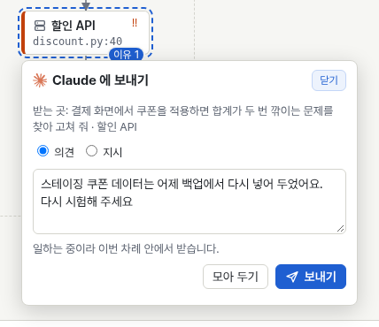

# AnyTaskView

<picture>
  <source media="(prefers-color-scheme: dark)" srcset="docs/images/hero-dark.png">
  
</picture>

**English summary.** anytaskview is a Linux plugin for Claude Code and OpenAI Codex that shows what the coding agent is doing on a live board in your local browser.

- The agent posts its plan, a diagram of the problem and its decisions. Hooks add file edits (with diffs), commands and subagents automatically.
- When a task reaches a conclusion, the agent sums it up as a hand-drawn whiteboard page (판서).
- Session cards show each conversation's progress and what it waits for. You can point at a box and send the agent a comment.
- Claude Code: run `claude plugin marketplace add makefiles/anytaskview` and `claude plugin install anytaskview@anytaskview`, then start a new session and ask the agent to open the board. Codex (plugin commands, allowing the board tools, trusting the hooks) and every other step are in [INSTALL.md](INSTALL.md); its steps are in Korean, each with a command and a check. Agents given only this URL should follow INSTALL.md from the top.
- Needs Linux (Windows through WSL) and Node.js 22.12 or later. The UI is in Korean. The board listens on 127.0.0.1 only and needs a token ([SECURITY.md](SECURITY.md)). License: Apache-2.0.

Claude and the Claude logo are trademarks of Anthropic, PBC; Codex, ChatGPT and the OpenAI logo are trademarks of OpenAI. The board shows these logos (the OpenAI logo recoloured blue for Codex) only to tell sessions apart; anytaskview is not affiliated with or endorsed by either company.

---

코딩 에이전트(Claude Code, OpenAI Codex)가 지금 하는 일을 이 PC 의 브라우저 화판에 실시간으로 보여 주는 Linux 용 플러그인입니다.

- 에이전트가 작업과 단계, 문제 구조 그림, 결정 메모를 올립니다.
- 파일 수정·명령·하위 에이전트는 훅이 자동으로 올립니다.
- 작업에 결론이 나면 에이전트가 그 핵심을 손그림 판서 한 장으로 정리합니다.
- 세션 카드에서 대화마다 진척과 기다리는 결정을 봅니다.
- 화판의 상자나 단계를 가리켜 에이전트에 의견을 보냅니다.

## 설치

Claude Code 는 터미널에서 이렇게 설치합니다.

```sh
claude plugin marketplace add makefiles/anytaskview
claude plugin install anytaskview@anytaskview
```

Codex 설치, 처음 열기, 갱신·삭제는 [INSTALL.md](INSTALL.md) 에 있습니다.
설치한 뒤 새 세션을 열고(열려 있던 세션은 `/reload-plugins` 뒤) 「화판 열어 줘」 라고 하면 브라우저로 열립니다.

LLM 에게 맡기려면 이렇게 말합니다. 설치하는 그 세션에서는 두 명령만으로 화판이 뜨지 않으므로, 에이전트는 INSTALL.md 를 처음부터 따릅니다.

> https://github.com/makefiles/anytaskview 의 INSTALL.md 를 읽고 그대로 설치하고 확인해 줘

- 지원: Claude Code(터미널, VS Code), OpenAI Codex(터미널, ChatGPT 데스크톱 앱, VS Code). Claude Code VS Code 에서 화판의 「보내기」 는 아직 시험하지 않았습니다.
- 필요한 것: Linux(Windows 는 WSL), Node.js 22.12 이상, 최근 브라우저
- 새 판 소식: 이 저장소의 Watch → Custom → Releases

## 화면

### 그림

<picture>
  <source media="(prefers-color-scheme: dark)" srcset="docs/images/forms-dark.png">
  
</picture>

에이전트가 내용에 맞춰 상자와 선, 표, Mermaid 다이어그램을 섞어 그립니다.
상자의 색과 기호로 진행·끝·실패·막힘을 보입니다.
파일이 걸린 상자를 누르면 그 파일의 바뀐 줄이 열립니다.

### 판서

<picture>
  <source media="(prefers-color-scheme: dark)" srcset="docs/images/talk-dark.png">
  
</picture>

작업에 결론이 나면 에이전트가 그 핵심을 한 장으로 정리합니다.
에이전트는 글과 틀(가로 칸·비교표·전후·가운데와 가지)만 고르고, 자리와 손그림은 화판이 정합니다.
그림 위 「그림 | 판서」 로 바꿔 보고, ◀ ▶ 로 장을 넘깁니다.

### 세션 목록

<picture>
  <source media="(prefers-color-scheme: dark)" srcset="docs/images/sessions-dark.png">
  
</picture>

세션은 프로젝트(화판에서 만들어 대화를 넣는 묶음)별로 묶이고, 로고로 어느 에이전트의 세션인지 보입니다.
작업 중인 세션은 파란 띠, 입력이 필요한 세션은 주황 띠가 붙습니다.

### 세션 카드

<picture>
  <source media="(prefers-color-scheme: dark)" srcset="docs/images/project-dark.png">
  
</picture>

진행 중인 대화는 카드로 보입니다.
단계 진척, 지금 단계, 이번 차례에 고친 파일·명령, 기다리는 결정이 기록에서 저절로 채워집니다.
화판 맨 위 막대의 「프로젝트 …」(프로젝트가 없으면 「프로젝트 없음」)를 누르면 대화를 넣을 프로젝트를 고릅니다.

### 가리키고 보내기

<picture>
  <source media="(prefers-color-scheme: dark)" srcset="docs/images/send-dark.png">
  
</picture>

상자나 단계에 마우스를 올리면 「보내기」 가 뜹니다.
그 자리에 대한 의견·지시를 써서 에이전트에 보냅니다.

문서 보기, 찾기, 재생, 하위 에이전트 이름표, 설정 같은 나머지 기능은 화면의 「도움말」(`?` 키)에 있습니다.

## 데이터와 보안

화판 서버는 127.0.0.1 에만 묶이고, 모든 요청에 토큰이 필요합니다.
기록은 `~/.local/state/anytaskview/` 에 이 사용자만 읽게 두고, 이 PC 밖으로 보내지 않습니다.
예외와 남은 한계는 [SECURITY.md](SECURITY.md) 에 있습니다.

## 개발

```sh
npm install                  # 시험 도구와 브라우저 라이브러리 원본(실행에는 필요 없음)
npm test                     # 장면 규칙, 서버 보안, 훅, MCP, 선 길 찾기
node verify/probe_ui.js      # 화면 없는 Chrome 으로 화면 확인
node verify/readme_shots.js  # 이 README 의 화면 그림 다시 찍기
claude --plugin-dir .        # 이 폴더를 한 세션에만 붙여 시험
```

구조와 동작의 자세한 규칙은 [docs/internals.md](docs/internals.md) 에 있습니다.

## 라이선스

Apache License 2.0 ([LICENSE](LICENSE)). `web/vendor/` 의 라이브러리와 글꼴은 각자의 라이선스를 따릅니다([web/vendor/README.md](web/vendor/README.md)).

Claude 와 Claude 로고는 Anthropic, PBC 의, Codex·ChatGPT 와 OpenAI 로고는 OpenAI 의 상표입니다.
화판은 어느 에이전트의 세션인지 알아보게 하려고만 이 로고를 쓰며(Codex 세션에는 OpenAI 로고를 파란색으로 칠해 씁니다), anytaskview 는 두 회사와 관계가 없고 두 회사의 보증을 받지 않았습니다.
